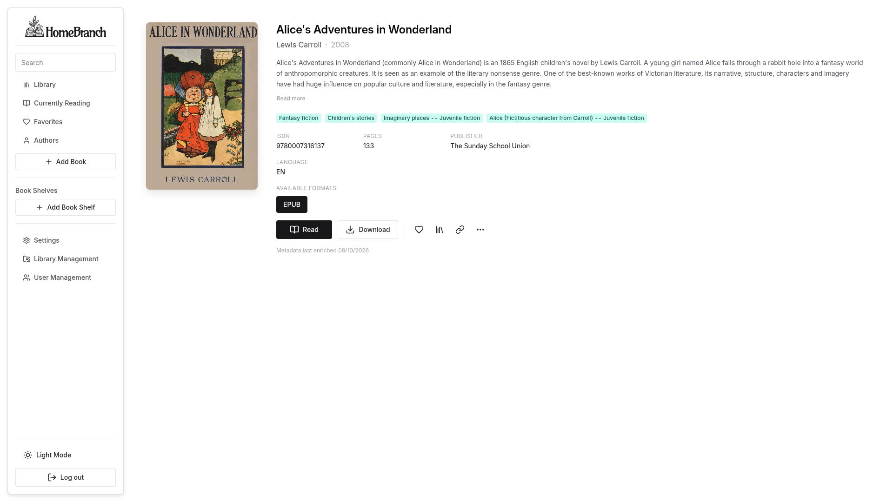

<picture>
  <source media="(prefers-color-scheme: dark)" srcset="public/Logo%202-Color%20For%20Dark.svg">
  
</picture>

Homebranch is a self-hosted web application for managing and reading your E-Book collection. 
It provides a user-friendly interface to organize, search, and read your ebooks across devices.

> The project workspace, integrated development stack, and contribution process are maintained in the [Homebranch project repository](https://github.com/Oghamark/homebranch).

> [!NOTE]
> The project is split into 3 repositories allowing you to choose the components you want to use:
> - [Homebranch Web](https://github.com/Oghamark/homebranch-web): The frontend web application built with React and TypeScript
> - [Homebranch](https://github.com/Oghamark/homebranch): The backend API built with NestJS and TypeScript
> - [Authentication](https://github.com/Oghamark/Authentication): A standalone authentication service built with NestJS and TypeScript, which can be used with Homebranch or as a general-purpose auth service for other applications

---

## Preview

<picture>
  <source media="(prefers-color-scheme: dark)" srcset="images/library_view.png">
  
</picture>
<picture>
  <source media="(prefers-color-scheme: dark)" srcset="images/book_details_view.png">
  
</picture>
<picture>
  <source media="(prefers-color-scheme: dark)" srcset="images/authors_view.png">
  
</picture>

---

## Features

- EPUB and PDF in-browser reading plus single- and multi-track MP3 and M4B audiobook playback, with cross-device listening-position sync
- Installable PWA with an offline-ready app shell for a more native-like experience
- Library with infinite scroll and search
  - Keyword search: `isbn:<value>`, `genre:<value>`, `series:<value>`, `author:<value>` prefixes narrow results by metadata field
- Book detail page with enriched metadata and format-aware actions: genres, series, ISBN, page count, publisher, language, ratings, format selection, and linked-format management
- Automatic metadata enrichment from Open Library and Google Books on upload
- Book shelves (collections)
- Currently Reading and Favorites lists
- Dark and light mode
- User management and roles
- Book clubs with discovery, private clubs, a shared reading plan, and spoiler-safe discussions
- EPUB, PDF, MP3, and M4B upload; selecting a directory groups its MP3 files into naturally ordered audiobook tracks
- SSO login via OIDC (configurable in the Settings page)
- Library Management page (admin): paginated job history with status filtering, book ownership management, linked-format maintenance, and book deduplication
- Real-time library updates via SSE — new, removed, or updated books reflect automatically without a manual page refresh; job progress streams live as jobs run

---

## Reading together

Open **Book Clubs** to visit **My clubs**, discover clubs open to people on your
Homebranch, or revisit archived clubs. Create a club using a book from your own
uploaded library. Private clubs are only visible to people an organizer adds;
adding a person does not send an invitation email.

Each club has a **Home**, **Reading plan**, and **Discussions**. Choosing your
reading copy is optional for conversations, but required to track club progress.
Your copy and private edition labels stay private, and progress sharing is off
unless you enable it. Club progress is separate from your private reader history.
Spoilers stay hidden until you choose to reveal an individual post or reply.

Owners and moderators use **Manage** for people and moderation. Owners can also
change club details and visibility, transfer ownership, archive, or permanently
delete a club. Editing retained reading steps preserves progress; removing steps
or changing your reading copy requires confirmation before associated club
progress is cleared. Archived clubs remain read-only and cannot be reopened.

For frontend checks, run `npm run typecheck`, `npm test`, and `npm run build`.
The scoped component tests cover the club flows without requiring live accounts.

---

## Installation

See our [documentation](https://homebranch.app/docs/getting-started/) for installation and configuration instructions.

---

## Contributing

Contributions are welcome! See the [Homebranch contribution guidelines](https://github.com/Oghamark/homebranch/blob/dev/CONTRIBUTING.md) for the project contribution process and integrated development setup.

---

## Credits

- "HomeBranch" Logo and Iconography  © 2026 [Acro Visuals, L.L.C.](https://acrovisuals.com) is licensed under CC BY-SA 4.0. To view a copy of this license, visit https://creativecommons.org/licenses/by-sa/4.0/
